# TRACE X: Cross-System Fraud Intelligence and Investigation Platform

**Azentio AI Hackathon, Challenge #01 · Team Byte Me**

| Item | Detail |
|---|---|
| Live application | https://trace-x-rouge-rho.vercel.app |
| Source code | https://github.com/AzentioHackathon-2026/Digital-Fraud-Investigation-System-byte-me |
| Sign-in | `test@agentio.com` (analyst) · `thanushgarimella@gmail.com` (administrator / supervisor) · password `agentio@123` |
| Report date | 31 October 2026 |

---

## 1. Executive summary

TRACE X ingests records from core banking, lending, insurance and digital channels and detects fraud that only becomes visible when those systems are read together. It explains every score with the records behind it and gives investigators a complete workspace. On top of that sits an agent team that investigates cases, learns from analysts' corrections and earns limited autonomy only where its measured accuracy justifies it.

**Headline results.** All numbers are reproducible with the commands in section 11. Every dataset is synthetic with planted fraud, and seeds 201 and 202 were kept sealed until final evaluation.

| Measure | Result |
|---|---|
| Planted fraud detected (8 detectors) | **18 / 18 on every seed**, including sealed seeds 201 and 202 |
| Legitimate lookalikes kept Low | **10 / 10 on every seed** |
| Precision of actionable alerts | 87 – 100 % across seeds (sealed: 90.9 % and 91.7 %) |
| Graph neural network, sealed test | ROC-AUC **0.997**, average precision **0.879**; at the validated threshold, precision **0.94** and recall **1.00** |
| Agent team accuracy, sealed seeds | **18 / 19 cases** (94.7 %), **99 %** of cited evidence verified in the database |
| Automated tests | **111** unit and integration tests, **20** Level 1 and **32** Level 2 end-to-end checks; all pass |
| Detection speed | about 160 ms for 10,000 records (6 source tables) |

<div class="checklist">
<h2 class="ck-title">Requirements checklist</h2>
<table class="ck-access"><tr><th>Live application</th><td><a href="https://trace-x-rouge-rho.vercel.app">https://trace-x-rouge-rho.vercel.app</a></td></tr>
<tr><th>Source code</th><td>https://github.com/AzentioHackathon-2026/Digital-Fraud-Investigation-System-byte-me</td></tr>
<tr><th>Analyst login</th><td><code>test@agentio.com</code> · password <code>agentio@123</code></td></tr>
<tr><th>Supervisor / admin login</th><td><code>thanushgarimella@gmail.com</code> · password <code>agentio@123</code></td></tr></table>
<h3>Level 1: Detect, score and manage fraud</h3><ul class="ck"><li><span class="bx">✓</span>CSV ingestion (parser, header aliases, field normalisation)</li><li><span class="bx">✓</span>Excel ingestion (multi-sheet XLSX)</li><li><span class="bx">✓</span>JSON ingestion (array and object-of-arrays)</li><li><span class="bx">✓</span>Mandatory-field validation (row-level errors, warnings, rejections)</li><li><span class="bx">✓</span>Duplicate detection and import summaries</li><li><span class="bx">✓</span>Data lineage (batch ID, source file, row, hash)</li><li><span class="bx">✓</span>FD-01 Suspicious transfers (amount, velocity, new beneficiary, baselines)</li><li><span class="bx">✓</span>FD-02 Shared-device fraud (coordinated identities)</li><li><span class="bx">✓</span>FD-03 Account takeover (failed logins, new device, sensitive activity)</li><li><span class="bx">✓</span>Legitimate lookalikes kept Low (household and shared-device context)</li><li><span class="bx">✓</span>Additional scenarios: loan, identity and insurance fraud</li><li><span class="bx">✓</span>Multi-indicator risk scoring (weights, mitigations, floors)</li><li><span class="bx">✓</span>Explainable risk linked to evidence</li><li><span class="bx">✓</span>Fraud dashboard (counts, severity, categories, latest findings)</li><li><span class="bx">✓</span>Alert search and filters (customer, transaction, product, risk, date, detector)</li><li><span class="bx">✓</span>Source evidence and event timelines</li><li><span class="bx">✓</span>Case queue (ID, customer, risk, alerts, status, evidence)</li><li><span class="bx">✓</span>Requires Investigation decision</li><li><span class="bx">✓</span>False Positive decision with reason</li><li><span class="bx">✓</span>Original alert preserved (immutable)</li><li><span class="bx">✓</span>Repeatable detection (run IDs, idempotent re-runs)</li></ul>
<h3>Level 2: Investigate, correlate and manage cases</h3><div class="ck-groups">
<div class="ck-group"><h4>1. Cross-system correlation</h4><ul class="ck one"><li><span class="bx">✓</span>Customers, accounts and transactions linked</li><li><span class="bx">✓</span>Devices, IP addresses and phone numbers linked</li><li><span class="bx">✓</span>Loan applications and payout accounts linked</li><li><span class="bx">✓</span>Insurance policies and claims linked</li><li><span class="bx">✓</span>Banking, lending and insurance correlated</li><li><span class="bx">✓</span>Links only through matching identifiers</li><li><span class="bx">✓</span>Related findings consolidated into one investigation</li><li><span class="bx">✓</span>Relationships behind each correlation explained</li></ul></div>
<div class="ck-group"><h4>2. Relationship analysis</h4><ul class="ck one"><li><span class="bx">✓</span>Interactive relationship network (Cytoscape)</li><li><span class="bx">✓</span>Customer, account, device, application, transaction and claim nodes</li><li><span class="bx">✓</span>Evidence-backed connections</li><li><span class="bx">✓</span>Select an entity to inspect its records</li><li><span class="bx">✓</span>Select a relationship to inspect its evidence</li><li><span class="bx">✓</span>Graph ↔ source records ↔ timeline navigation</li><li><span class="bx">✓</span>Fraud paths and connected entities highlighted</li></ul></div>
<div class="ck-group"><h4>3. Case consolidation</h4><ul class="ck one"><li><span class="bx">✓</span>Related alerts grouped into one case</li><li><span class="bx">✓</span>Reason for grouping explained</li><li><span class="bx">✓</span>Shared identifiers and linking evidence shown</li><li><span class="bx">✓</span>Original alerts preserved</li><li><span class="bx">✓</span>Analyst-driven case splitting</li><li><span class="bx">✓</span>Reason required to split</li><li><span class="bx">✓</span>Split and supersession history kept</li><li><span class="bx">✓</span>Split persists across detection re-runs (tested)</li></ul></div>
<div class="ck-group"><h4>4. Investigation workspace</h4><ul class="ck one"><li><span class="bx">✓</span>Detailed case timeline</li><li><span class="bx">✓</span>Affected customers and entities</li><li><span class="bx">✓</span>Fraud indicators and explanations</li><li><span class="bx">✓</span>Source evidence and references</li><li><span class="bx">✓</span>Risk and confidence</li><li><span class="bx">✓</span>Investigation notes</li><li><span class="bx">✓</span>Requires Investigation</li><li><span class="bx">✓</span>False Positive with reason</li><li><span class="bx">✓</span>Request Additional Information</li><li><span class="bx">✓</span>Escalate to Specialist / Supervisor</li><li><span class="bx">✓</span>Recommend Temporary Hold</li><li><span class="bx">✓</span>Recommend Enhanced Verification</li><li><span class="bx">✓</span>Record Investigation Conclusion</li><li><span class="bx">✓</span>Investigator identity and timestamps retained</li><li><span class="bx">✓</span>Human approval for customer-impacting actions</li></ul></div>
<div class="ck-group"><h4>5. Evidence and audit trail</h4><ul class="ck one"><li><span class="bx">✓</span>Original source records preserved</li><li><span class="bx">✓</span>Fraud indicators stored</li><li><span class="bx">✓</span>AI assessments stored</li><li><span class="bx">✓</span>Analyst notes and corrections stored</li><li><span class="bx">✓</span>Previous risk classification stored</li><li><span class="bx">✓</span>Decisions with time and user identity</li><li><span class="bx">✓</span>Append-only investigation history</li><li><span class="bx">✓</span>Superseded cases preserved</li><li><span class="bx">✓</span>Structured JSON case report</li><li><span class="bx">✓</span>Downloadable PDF case report</li><li><span class="bx">✓</span>Supporting evidence included in reports</li></ul></div>
<div class="ck-group"><h4>6. Prioritisation</h4><ul class="ck one"><li><span class="bx">✓</span>Prioritised by risk and severity</li><li><span class="bx">✓</span>Estimated financial exposure</li><li><span class="bx">✓</span>Linked alerts and cross-system relationships considered</li><li><span class="bx">✓</span>Evidence confidence displayed</li><li><span class="bx">✓</span>Monitored vs actionable findings</li><li><span class="bx">✓</span>Prioritised case queue</li><li><span class="bx">✓</span>Exposure at case and dashboard level</li><li><span class="bx">✓</span>Low-evidence cases routed to Needs More Evidence (tested)</li></ul></div>
</div><h3>Built beyond Level 1 and Level 2</h3><ul class="ck three"><li><span class="bx">✓</span>FD-08 Dormant account reactivation</li><li><span class="bx">✓</span>Isolation Forest anomaly model</li><li><span class="bx">✓</span>Graph neural network on the customer graph</li><li><span class="bx">✓</span>FD-GNN monitored model-only findings</li><li><span class="bx">✓</span>Four-agent team: orchestrator, hypothesis, SQL, reviewer</li><li><span class="bx">✓</span>LLM investigation (gpt-4o-mini)</li><li><span class="bx">✓</span>Read-only, guarded SQL tools</li><li><span class="bx">✓</span>Evidence-ID verification (fabricated IDs dropped)</li><li><span class="bx">✓</span>Deterministic agent fallback</li><li><span class="bx">✓</span>Lessons learned from analyst feedback</li><li><span class="bx">✓</span>Per-category agent trust scores</li><li><span class="bx">✓</span>Trust-gated autonomy L0–L3 (threshold crossing tested)</li><li><span class="bx">✓</span>Kill switch and autonomous allow-list</li><li><span class="bx">✓</span>Human-in-the-loop approvals</li><li><span class="bx">✓</span>Agent Trust dashboard</li><li><span class="bx">✓</span>Agent evaluation (deterministic vs LLM)</li><li><span class="bx">✓</span>Held-out ML benchmark (sealed seeds 201, 202)</li><li><span class="bx">✓</span>Feedback-based policy suggestions (never auto-applied)</li><li><span class="bx">✓</span>Session telemetry and payee-name check fields</li><li><span class="bx">✓</span>Workspace activity audit</li><li><span class="bx">✓</span>Persistent Turso database</li><li><span class="bx">✓</span>Production reset safeguards</li><li><span class="bx">✓</span>Responsive mobile screens and dark mode</li><li><span class="bx">✓</span>Model card and agent evaluation docs</li></ul>
<p class="ck-note">21 Level 1 items, 57 Level 2 items and 24 additional features, all implemented and verified by the automated tests and end-to-end checks in section 11 or the screenshots in this report.</p></div>

---

## 2. The problem and our approach

Fraud rarely stays inside one system. A loan ring opens accounts in banking, applies in lending and cashes out through insurance. An account takeover starts in the digital channel and ends in a transfer to a mule. Each step looks minor where it happens, so product-siloed controls miss the pattern.

TRACE X answers four questions for every case:

1. **What happened?** A chronological journey across systems, with each event's role marked.
2. **Why is it suspicious?** Weighted signals and legitimate-context mitigations, each citing source records.
3. **How sure are we, and how much is at stake?** Risk, evidence confidence, financial exposure, priority and agent trust, kept as separate numbers.
4. **What should happen next, and who decides?** Recommended actions, an approval workflow for anything customer-impacting, and an immutable audit trail.

---

## 3. Architecture

```
 CSV / Excel / JSON  ──►  Ingestion & validation  ──►  libSQL / Turso source tables
                                                       (every row keeps file, row, hash)
                                     │
       ┌─────────────────────────────┼──────────────────────────────┐
       ▼                             ▼                              ▼
 Rule detectors FD-01..FD-08   Isolation Forest (transfers)   Graph neural network (customers)
 explainable signals and       FD-ML model-only findings      FD-GNN model-only findings
 mitigations
       └─────────────────────────────┬──────────────────────────────┘
                                     ▼
          FD-06 cross-system correlation  →  consolidated cases (immutable alerts)
                                     ▼
   Investigation workspace: graph · timeline · evidence · actions · approvals · reports
                                     ▼
   Agent team: orchestrator → hypothesis → SQL → reviewer → verification → feedback-learning
                                     ▼
   Agent Trust & Autonomy Engine (per category · Beta-Binomial · held-out · kill switch)
```

**Stack:** Next.js 16 (App Router), TypeScript, libSQL/Turso, Cytoscape.js, zod, Tailwind CSS, and the OpenAI API (gpt-4o-mini) for the agent team. Deployed on Vercel. All models (Isolation Forest, GNN, Beta-Binomial trust) are implemented in the repository with no external ML service.

**Integrity by design:**

- Alerts, cases, decisions, actions, splits, agent feedback and the autonomous-action log are append-only, enforced by database triggers rather than application code.
- Alert identities are content hashes, so re-running detection is idempotent.
- Reset is the only path that removes data, and the activity log survives it.

---

## 4. Level 1 capabilities

### 4.1 Sign-in and roles

Two roles exist. An analyst investigates and records actions. An administrator (supervisor) can also approve customer-impacting recommendations, reset the workspace and control agent autonomy. Sessions are HMAC-signed cookies; passwords are stored as scrypt hashes.

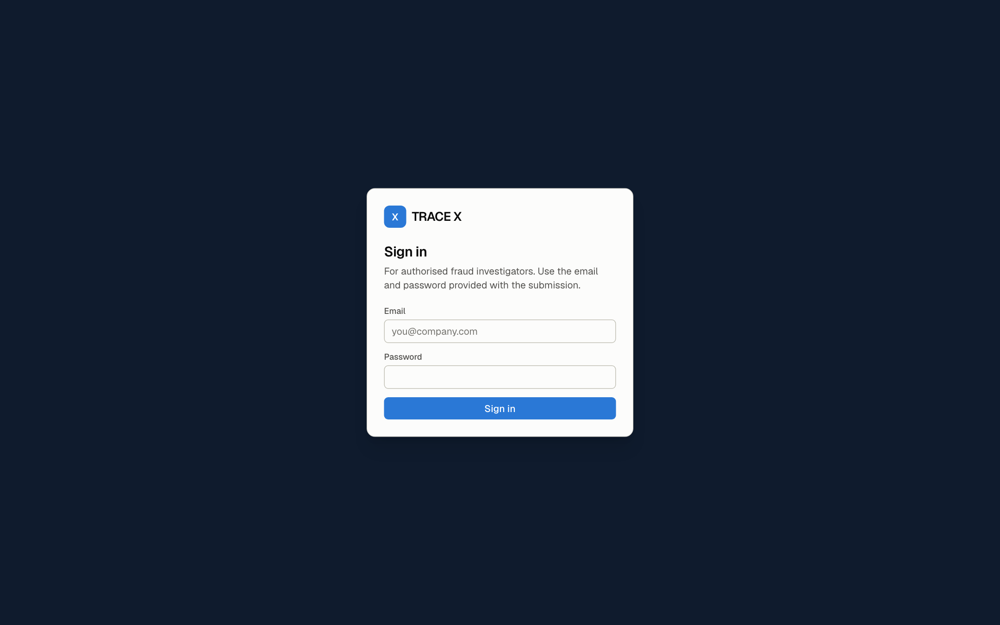

### 4.2 Data ingestion and validation

- **Formats and headers:** CSV, Excel and JSON for all six record types: customers, accounts, transactions, login events, loan applications and insurance claims. Headers are matched through aliases, so another system's column names work ("Cust ID", "Login Time", "Auth Result").
- **Dates and amounts:** date order is detected per column; currency symbols, Dr/Cr notation and negative amounts are normalised.
- **Row-level outcomes:** every row is accepted, accepted with a warning, rejected or flagged as a duplicate, with the reason shown. The screenshot shows a deliberately broken file: one valid row, plus a missing ID, an impossible date, a negative amount, unknown accounts and duplicates.

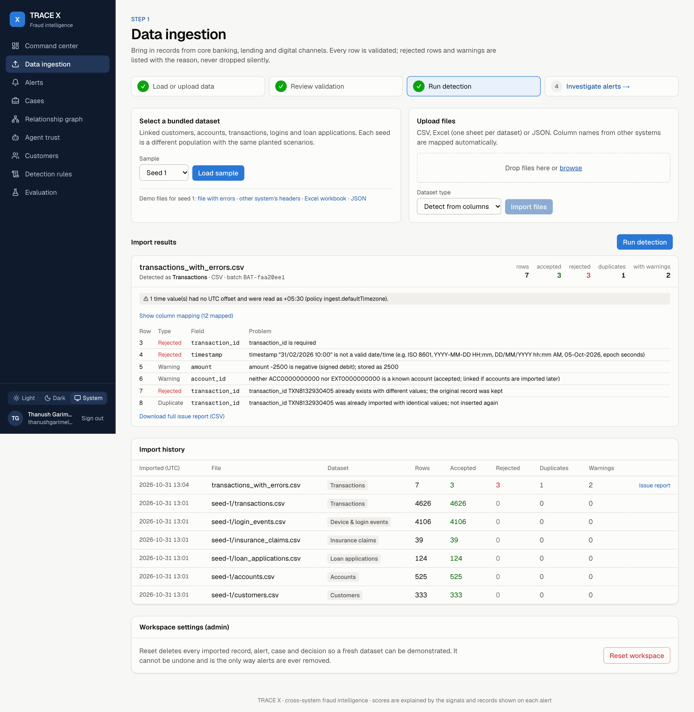

### 4.3 Detection engine

Eight rule detectors produce explainable findings. Each finding carries weighted **signals** (adding risk) and **mitigations** (legitimate context removing risk), and every signal cites the records it used.

| Detector | Detects | Example signals | Example mitigations |
|---|---|---|---|
| FD-01 Suspicious transfer | Unusual amounts, new beneficiaries, drained new accounts, mule fan-in | Amount outlier (robust z), new beneficiary, drain after inflow, payee-name mismatch | Within customer's norm, established beneficiary, payee name verified |
| FD-02 Coordinated device use | Many new, unrelated profiles on one device | Three or more profiles, short first-use window, shared payout, all recently onboarded | Same household, long-standing shared use |
| FD-03 Account takeover | Failed-login burst or phished credentials, then access and money movement | Failed burst, new device, new location, SIM swap, remote-access tool, behaviour mismatch | Known device, behaviour consistent |
| FD-04 Identity / synthetic | Shared national ID, phone or email; implausible profiles | ID reuse under another name, shared contact, clustered onboarding, implausible attributes | Same household, no ID reuse |
| FD-05 Loan application fraud | Application rings | Shared payout account, shared device, velocity, income mismatch | Same household, no shared payout |
| FD-06 Cross-system | Alerts from several detectors linked by shared entities | Strongest member, independent detectors, multiple products, bridging entities | — |
| FD-07 Insurance claim fraud | Duplicate invoices and incidents, early claims, payouts to others | Duplicate document or incident, early claim, near sum insured, shared payout, late reporting | Household payout, long-standing policy |
| FD-08 Dormant reactivation | Long-dormant accounts suddenly moving money | Dormant then active, large inflow, pass-through, new payees | Only payees paid before dormancy, small amounts |
| FD-ML Isolation Forest | Transfers that are statistical outliers but match no rule | 14 behavioural features, seeded | — |
| FD-GNN Graph neural network | Customers whose records and neighbours look like known fraud | 26 features × 3 hops | — |

**Scoring:** score = Σ signals − Σ mitigations, clamped to 0–100, with severity floors for decisive patterns. Levels are High ≥ 70, Medium 40–69 and Low < 40. High and Medium alerts open cases. Low alerts are kept as "monitored", together with the reason they were not escalated.

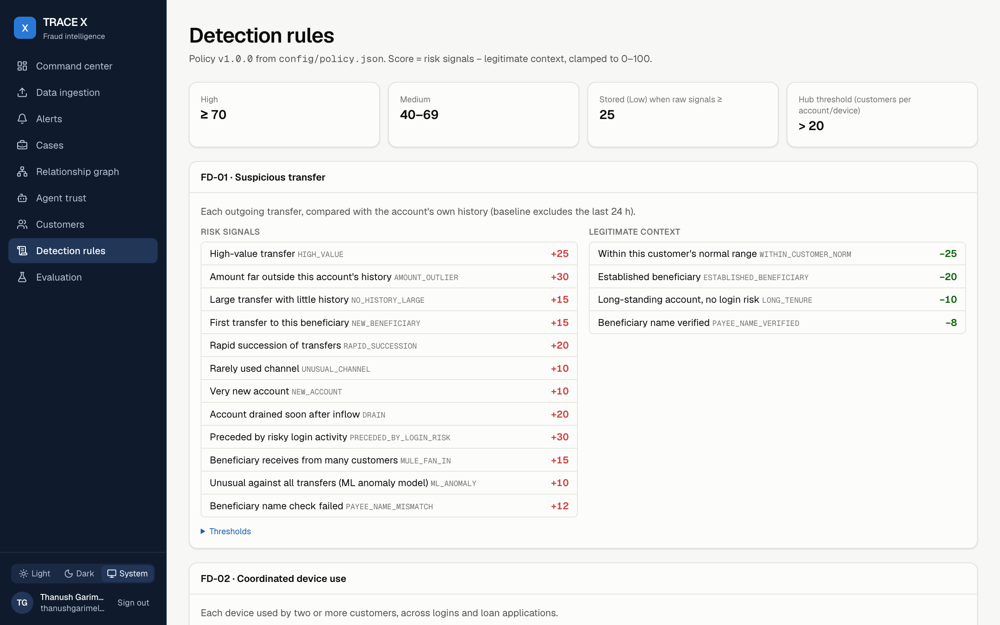

### 4.4 Command center (dashboard)

The dashboard shows everything computed from the workspace: records processed, flagged events, risk distribution and alerts over time. It also shows a priority-ordered investigation list (with exposure and confidence), the agent trust overview, the dataset and detection run displayed, and a workspace activity log recording who loaded, reset, decided or approved what.

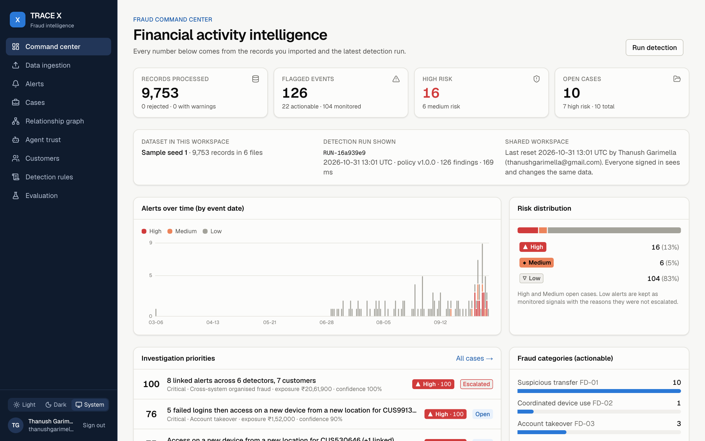

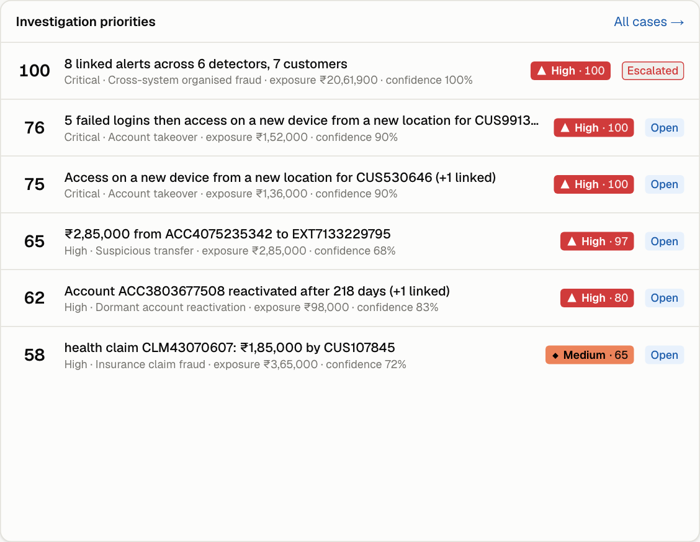

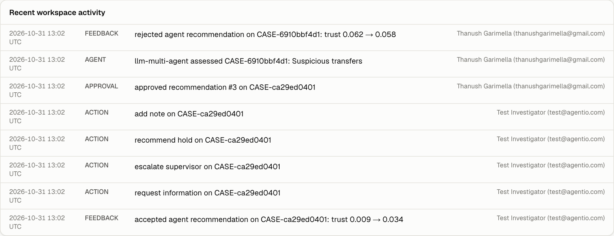

### 4.5 Alert explorer

Tabs split actionable alerts from monitored ones. Filters cover customer, transaction, product, risk level, detector, review status, date range and free-text search. Each row shows the strongest reason, any legitimate context, the case it belongs to, and a link to investigate.

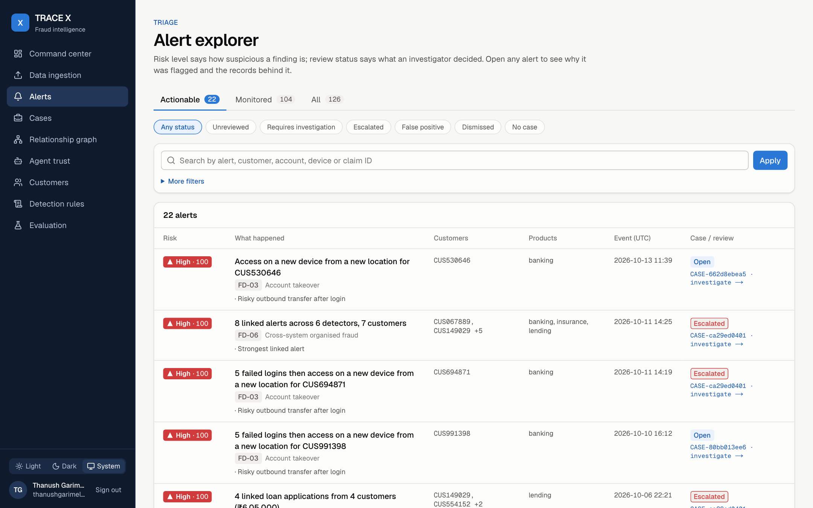

The alert detail page shows the scoring breakdown, linked entities, the timeline and every source record. Below is an account-takeover alert that uses the new session-telemetry signals (SIM swap, remote-access tool, behaviour mismatch).

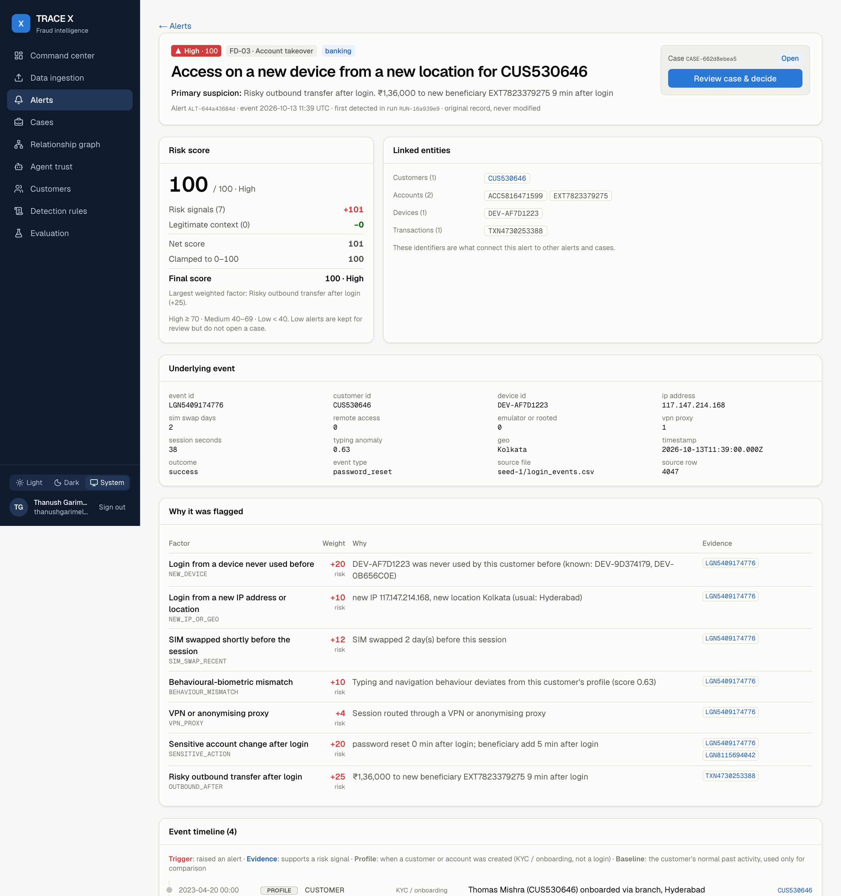

### 4.6 Case queue

Cases are ordered by investigation priority, not by raw score. Each row shows priority tier, risk, exposure, evidence confidence, category, customer, alert count and review status. Cases that a newer detection run superseded keep their decisions under a separate tab.

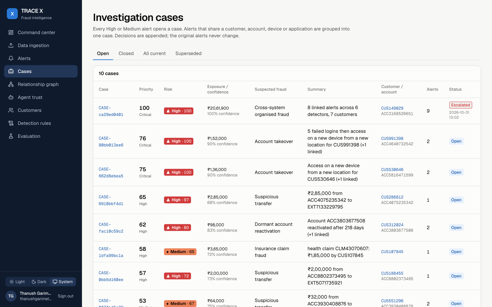

### 4.7 Customer profile

A customer's profile brings together their accounts, devices, logins, transfers, applications, claims, alerts and cases.

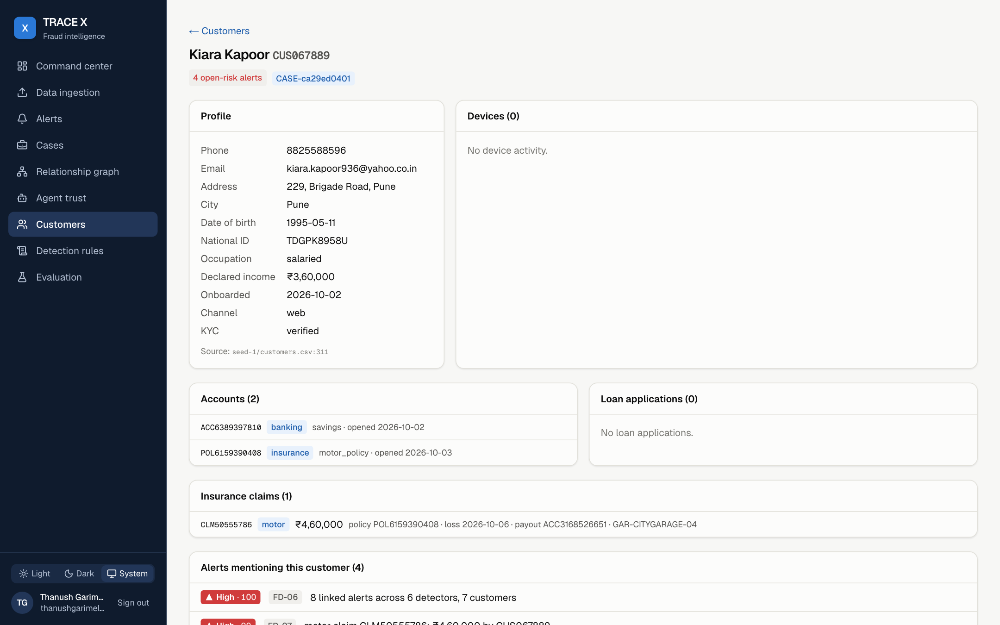

---

## 5. Level 2 capabilities

### 5.1 Cross-system fraud correlation (requirement 1)

FD-06 links alerts through **every required entity type**: customer, account or beneficiary, device, IP address, phone, loan application, transaction, insurance policy and claim. Invoice documents link alerts as well.

- **Grounded links:** every link comes from a matching identifier in the source records.
- **Time-aware:** phone, IP, policy and document links join alerts only within a 45-day window.
- **Hub attenuation:** high-degree hubs such as merchant accounts, kiosk devices and shared IPs are excluded, so unrelated customers are not merged.
- **Tested:** each entity type has its own test.

### 5.2 Interactive relationship graph (requirement 2)

Built with Cytoscape.js:

- **Entities:** 13 types, each with its own shape and colour, joined by directed, labelled edges such as owns, transfer (with amount), applied, payout to, claimed, under policy, invoice, login from and has phone.
- **Highlighting:** suspicious paths are drawn in red. Bridge entities that connect several systems get a double ring, and hubs are drawn dashed and not expanded. A customer's node size is their graph-model probability.
- **Inspection:** clicking a node or edge shows the exact matching field (for example `loan_applications.payout_account`), first and last seen times, the amount, linked alerts and the source records, with links to the record table and to the event in the timeline.
- **Filters:** entity type, product, minimum risk, date range, entity search and "suspicious links only".
- **No invented edges:** a test resolves every edge's evidence against the database.

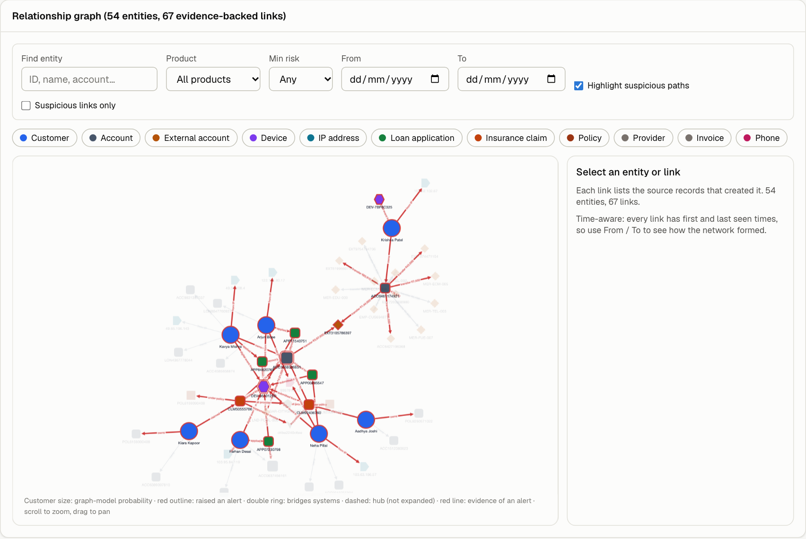

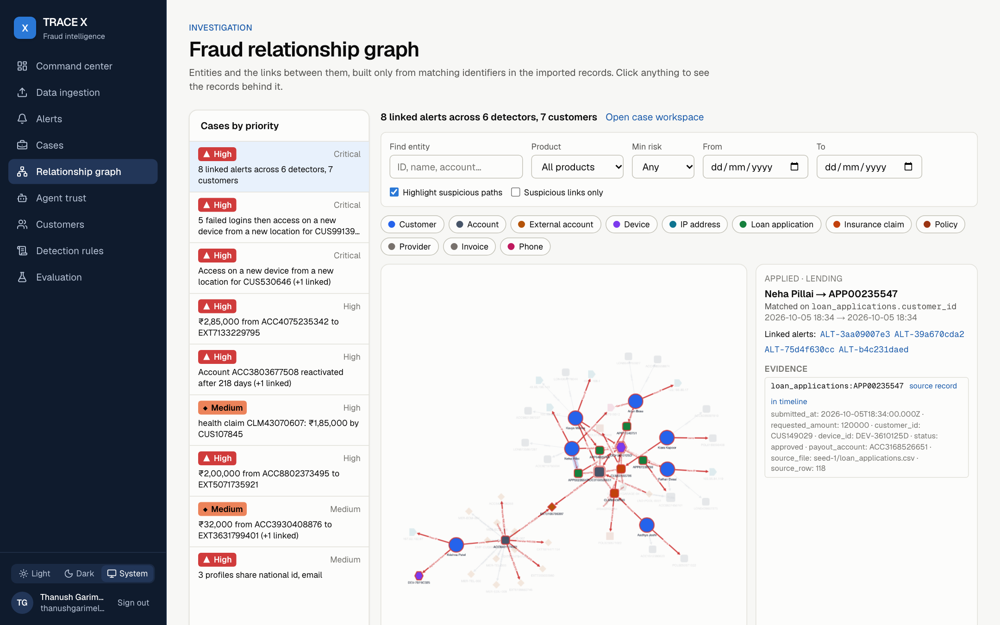

### 5.3 Intelligent case consolidation and splitting (requirement 3)

The case page explains **why alerts were grouped**: each shared entity, the source field that matched, which alerts it links, how far apart in time they were and whether that falls inside the correlation window. It also lists the hubs that were excluded.

Analysts can **split** wrongly grouped alerts into a new case, giving a reason:

- **Nothing is lost:** original alerts, evidence and decisions are untouched, and the move is an append-only record.
- **The split sticks:** a later detection run keeps the two groups apart, and the analyst's case IDs stay stable.
- **The old summary goes:** the combined cross-system summary alert is retired, because it no longer describes either half.

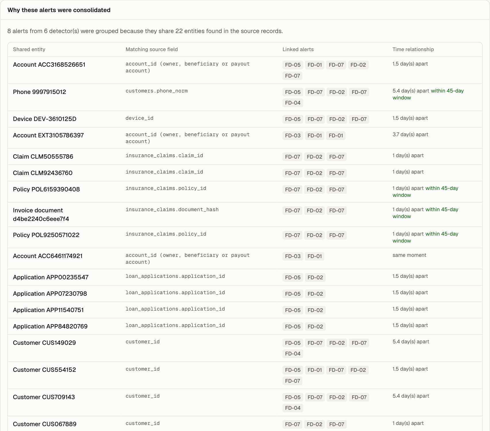

### 5.4 Complete investigation workspace (requirement 4)

The case page brings together:

- the score strip and its breakdown;
- investigation actions;
- the agent investigation;
- the investigation brief;
- the graph-model view;
- the relationship graph;
- the consolidation explanation;
- the cross-system journey timeline;
- the full source records.

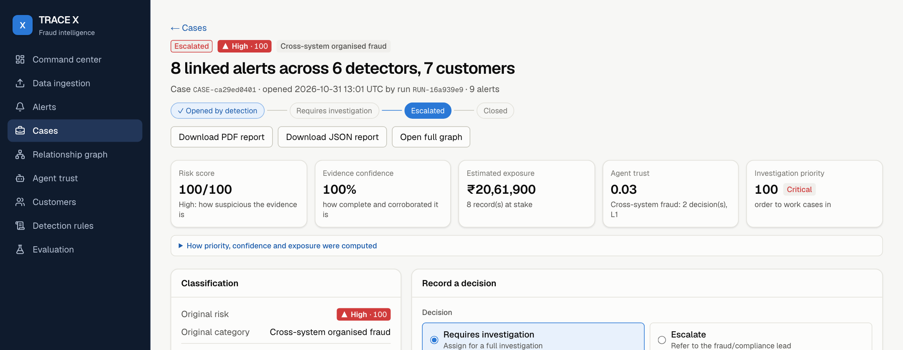

**Actions:** Requires Investigation, False Positive (reason required), Request Information, Escalate to Specialist, Escalate to Supervisor, Recommend Temporary Hold, Recommend Enhanced Verification, Close Case, Add Investigator Note and Record Investigation Conclusion (confirmed fraud, not fraud or inconclusive).

- **Recorded in full:** every action stores status, actor and timestamp in an append-only history.
- **Approval required:** hold and enhanced verification are customer-impacting, so they stay **recommendations** until a supervisor approves them. The approver must be an administrator other than the person who raised the request. Even an approval is only a record for operations; TRACE X never places holds or changes accounts.

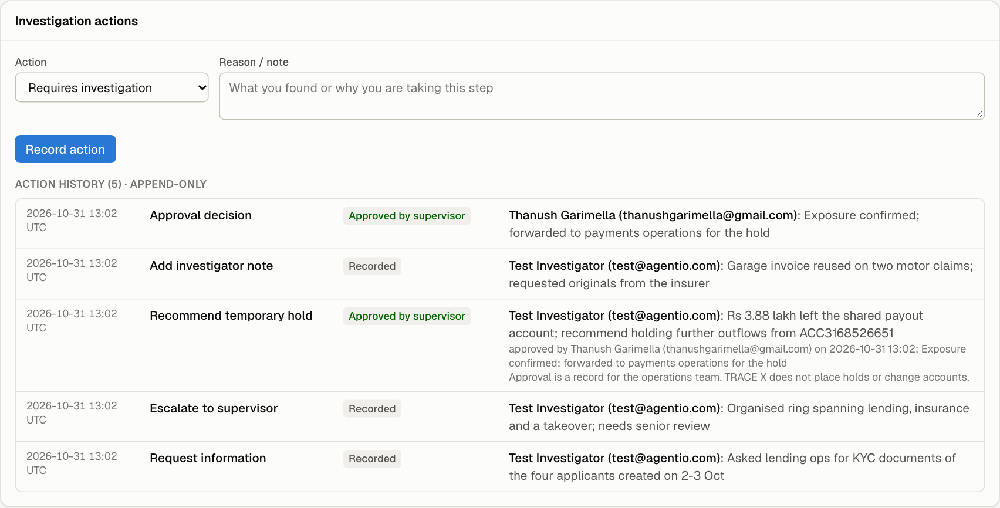

**Timeline:** every event is labelled with its role and source system:

- **Trigger:** the event raised an alert.
- **Evidence:** it supports a signal.
- **Profile:** a customer or account was created (KYC, not a login).
- **Baseline:** the customer's normal history, used only for comparison and folded away.

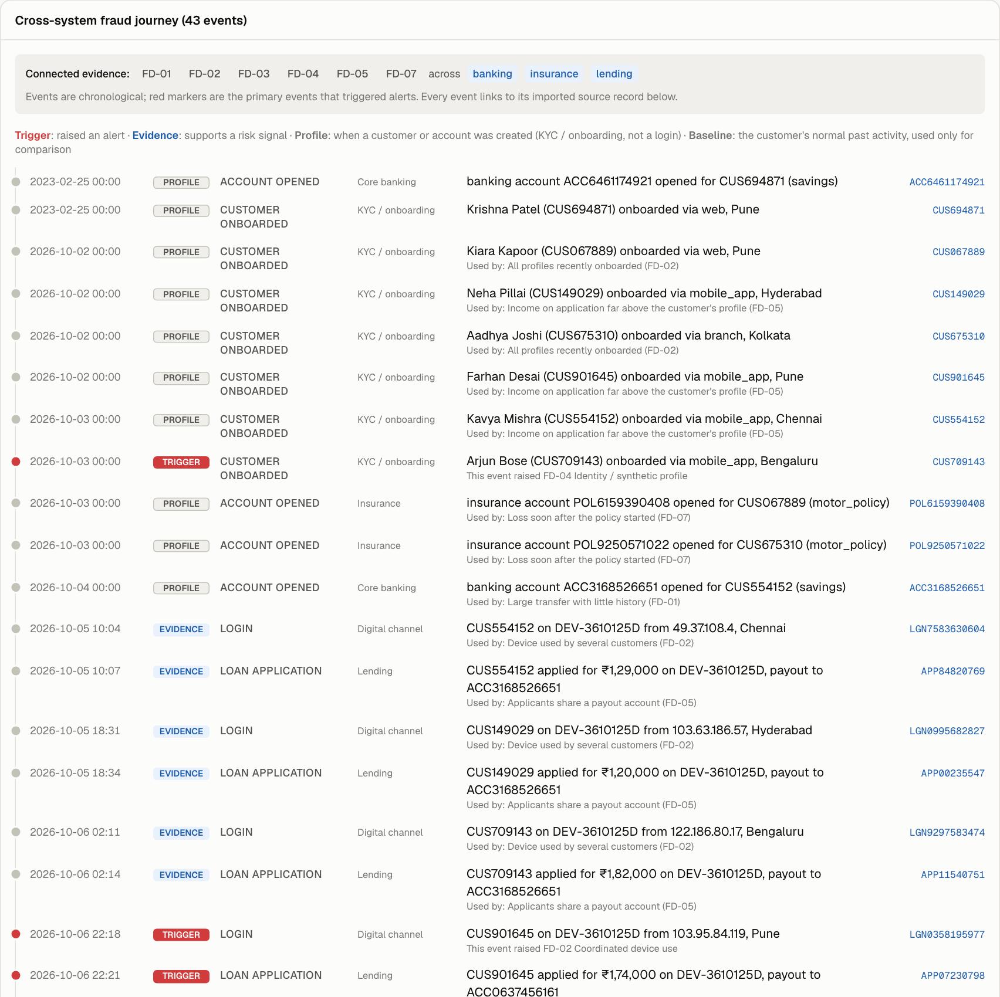

**Investigation brief:** a deterministic summary in which every sentence cites the records it uses, followed by next checks.

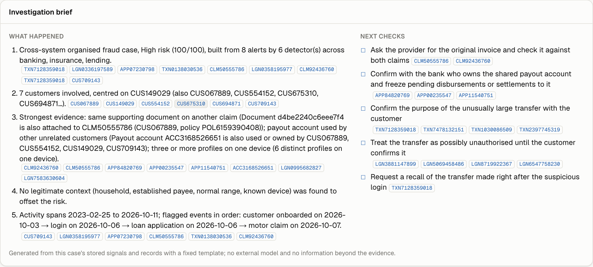

**Evidence:** every source record, with its file and row of origin.

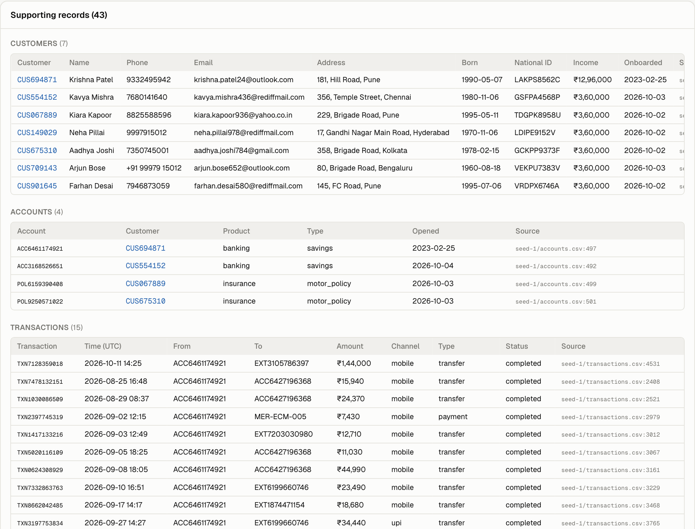

### 5.5 Evidence management and structured case report (requirement 5)

The report can be downloaded as **PDF** or structured **JSON**. It contains:

- case details and the separate scores;
- the consolidation explanation and splits;
- every alert with its signals and mitigations;
- the timeline and graph relationships, each with its evidence;
- agent assessments, including tool calls and SQL;
- decisions, actions and approvals;
- an evidence index giving each record's source file, row and hash.

Every reference is re-resolved against the database when the report is built: the number of unresolved references is reported and tested to be zero. A SHA-256 integrity hash covers the report content.


### 5.6 Explainable prioritisation (requirement 6)

Five quantities are kept separate and never merged:

| Quantity | Answers | Built from |
|---|---|---|
| Risk score | How suspicious is the evidence? | Detector signals − mitigations |
| Evidence confidence | How complete and corroborated is it? | Independent detectors, source systems, record count, records resolved, contradicting context |
| Financial exposure | How much money is at stake? | Flagged transfers, requested loans and claimed amounts, each record counted once |
| Investigation priority | What should be worked first? | Weighted: risk 35 %, exposure 25 %, diversity 15 %, confidence 10 %, takeover 5 %, cross-system 10 % |
| Agent trust | How reliable is the agent in this fraud category? | Analyst feedback (section 7) |

A case with confidence below 45 % and no cross-system corroboration is marked **Needs More Evidence**, and its priority is capped instead of being escalated on risk alone.

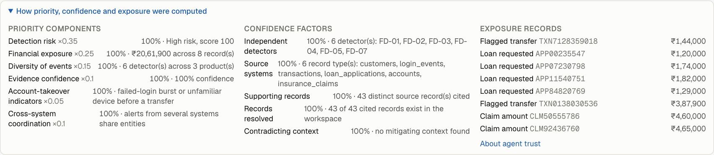

---

## 6. Machine learning

### 6.1 Isolation Forest on transfers

A seeded Isolation Forest (100 trees, 256 samples) scores every outgoing transfer on 14 behavioural features, including:

- amount against the account's own history;
- hour against the customer's usual hour;
- whether the beneficiary is new and how many senders it has;
- channel rarity, account age and 24-hour velocity;
- outflow against recent inflow and amount against declared income.

The top 0.2 % adds a weighted signal to FD-01. The top 0.5 % that no rule caught becomes a Low FD-ML finding, which widens coverage without flooding the queue.

### 6.2 Graph neural network on the customer graph

**Graph.** Customers are joined when they share a device, phone, email, national ID, payout or beneficiary account, or invoice. Hubs are excluded. Edge weights are discounted by group size.

**Features.** 26 per-customer features computed from raw records. No rule-detector output and no labels are used. One feature, the highest Isolation Forest percentile among the customer's transfers, comes from the transfer anomaly model, so the GNN is independent of the rules but not of the Isolation Forest. They cover:

- tenure;
- devices and failed logins;
- session telemetry;
- transfer behaviour;
- payee-name mismatches;
- isolation-forest percentile;
- drain ratio;
- loans against income;
- claims against sum insured;
- device and account sharing.

**Model.** SIGN-style propagation concatenates the node's own features with its 1-hop and 2-hop neighbourhood features (Kipf-Welling normalisation). An MLP trained with Adam on weighted cross-entropy sits on top. Propagation is fixed rather than learned, a deliberate choice for small graphs on CPU-only serverless.

**Evaluation protocol.** Data is split by dataset, so no customer appears in two splits:

- **Train:** seeds 1–3 (999 customers, 51 fraud-linked).
- **Validation:** seed 101, used only to choose the model and threshold.
- **Sealed test:** seeds 201 and 202 (666 customers, 34 fraud-linked), scored once after selection.

| Model | Validation AP | Sealed test AUC | Sealed test AP |
|---|---|---|---|
| Logistic regression, own features (no graph) | 0.809 | 0.991 | **0.886** |
| Logistic regression on graph features (SGC) | 0.810 | 0.997 | 0.857 |
| GNN: SIGN + MLP(16) | 0.893 | 0.997 | 0.862 |
| **GNN: SIGN + MLP(32), selected** | **0.980** | **0.997** | 0.879 |

At the threshold chosen on validation (0.29), the GNN flags 36 of 666 sealed-test customers, with **precision 0.94 and recall 1.00**.

**Reading these results honestly.** The GNN clearly won on validation. On the sealed test it ties the no-graph baseline: the baseline's average precision is slightly higher, and the GNN's AUC is slightly higher. The graph's practical value is that it explains a customer's risk through their linked neighbours, which the investigator sees on the case page. Because fraud scenarios in the synthetic data are structurally obvious, every model scores high; these figures show the method generalises across datasets, not real-world accuracy.

Customers above the threshold with no actionable rule alert become **FD-GNN** monitored findings. Each is explained by its drivers (feature occlusion) and its graph neighbours.

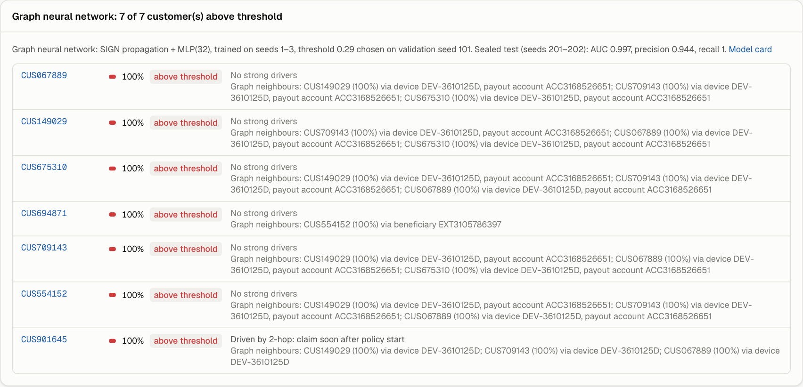

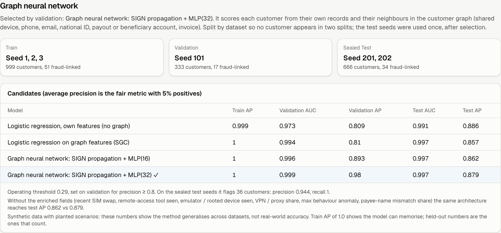

---

## 7. Adaptive agentic investigator

### 7.1 The agent team

| Step | Agent | What it does |
|---|---|---|
| 1 | Orchestrator | Reads the case and writes a brief, the entities to focus on, open questions and a hypothesis budget |
| 2 | Hypothesis agent | Proposes competing explanations, fraud and legitimate, citing case IDs; applies lessons from past corrections |
| 3 | SQL agent | Writes read-only SQL to test each hypothesis; failed queries get one self-repair round with the error message |
| 4 | Reviewer agent | Judges each hypothesis from the query results; returns verdicts, confidence, cited IDs, an investigation-quality score, recommended actions and missing information |
| 5 | Code verification | Checks every cited ID against query results and the database; drops anything not found; downgrades a "supported" verdict that has no verified citation |
| 6 | Feedback-learning agent | Compares the conclusion with the analyst's verdict and writes a short, general lesson that is retrieved into future prompts for the same detector signature |

**Safety boundaries:**

- **Narrow SQL access:** the SQL agent sees only source tables and graph scores, never case decisions, feedback or lessons, so it cannot read the answer it is graded on. Each query must be a single SELECT; it runs inside an outer SELECT with a 50-row cap, and write keywords are blocked.
- **Approval stays with humans:** customer-impacting recommendations are always marked as requiring human approval.
- **Fallback:** without an API key, or on any model error, a deterministic tool-using agent runs instead, and the panel says so.

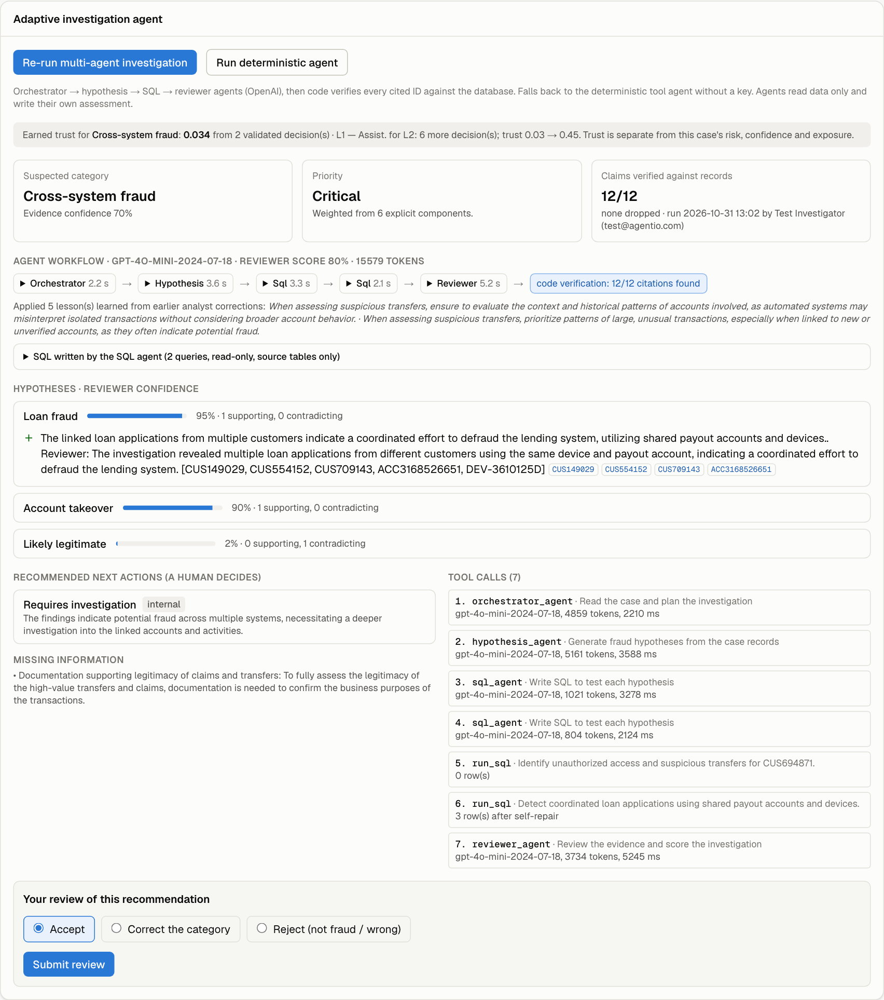

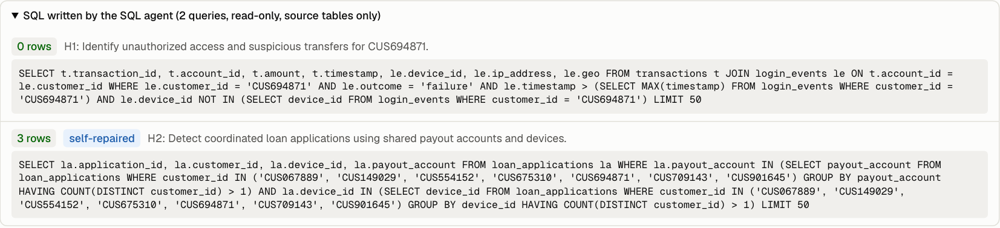

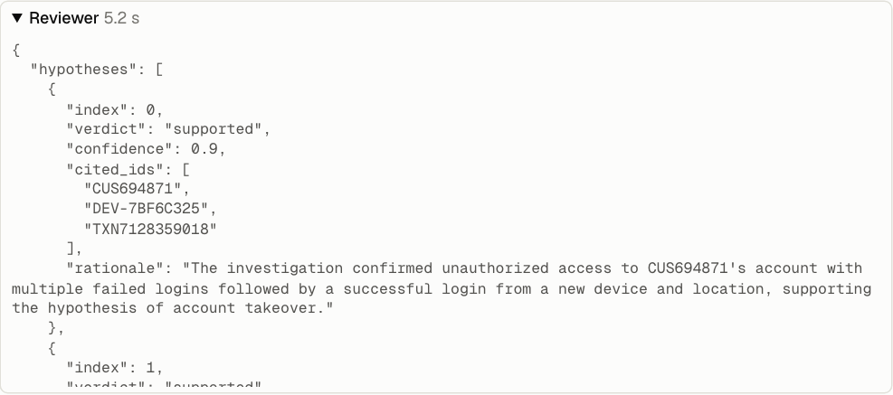

### 7.2 Agent Trust & Autonomy Engine

- **Per-category trust.** Trust is tracked separately for account takeover, shared-device coordination, identity fraud, loan fraud, insurance fraud, suspicious transfers and cross-system fraud.
- **Starts at zero.** Every category begins with zero trust and zero autonomous permissions.
- **Feedback capture.** Every analyst review records whether the recommendation was accepted, corrected (with the right category) or rejected, plus the reasoning and evidence IDs. Evidence IDs are validated against the database.
- **Model.** For each category, Beta(1 + s, 1 + f), where accepted recommendations add their evidence-grounding ratio to s, and corrected or rejected ones add 1 to f.
- **Trust score.** The lower 5 % credible bound, measured above the uninformed prior, multiplied by a volume discount until 20 decisions exist. Correct decisions raise it, incorrect ones lower it, and a small sample keeps it low.
- **Held out.** 25 % of cases, chosen by a hash of the case ID, are held out: they validate trust but never change it or create lessons.
- **Autonomy levels.**
    - **L0 (Observe):** no validated decisions; the agent analyses and a human approves everything.
    - **L1 (Assist):** at least one validated decision; evidence-backed suggestions.
    - **L2 (Recommend):** at least 8 decisions and trust of 0.45 or more; prioritised actions that a human confirms.
    - **L3 (Limited autonomy):** at least 20 decisions, trust of 0.7 or more, and at least 5 held-out decisions at 80 % or better accuracy. Only allow-listed, reversible, internal actions: label case, route to queue, request analyst review.
- **Controls.** Administrators can only tighten the thresholds, within safe floors. A global kill switch stops all autonomous actions.
- **Never autonomous.** Holds, blocks, account restrictions, fund transfers and final adverse decisions.

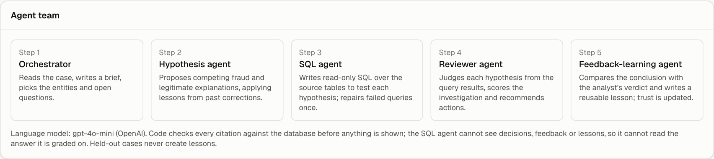

The trust curve below is computed from real feedback. Red rings mark points where trust fell after a wrong recommendation.

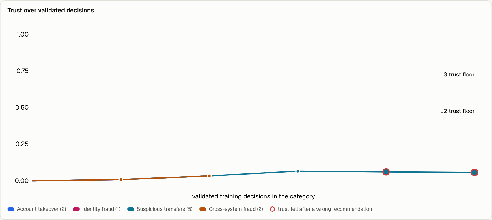

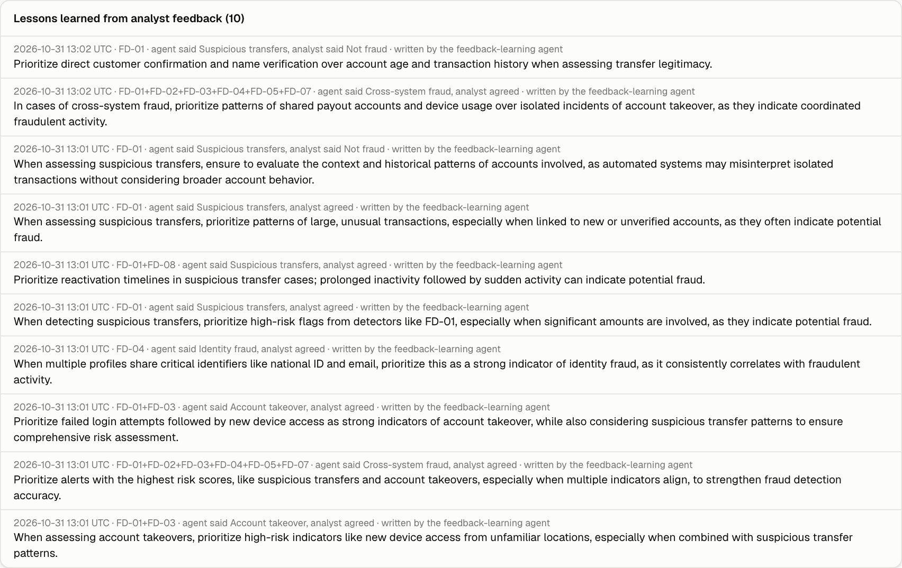

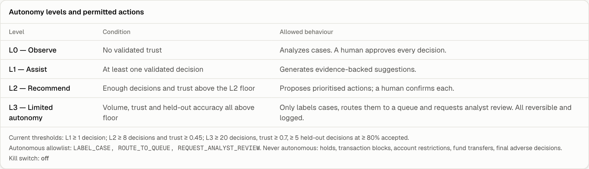

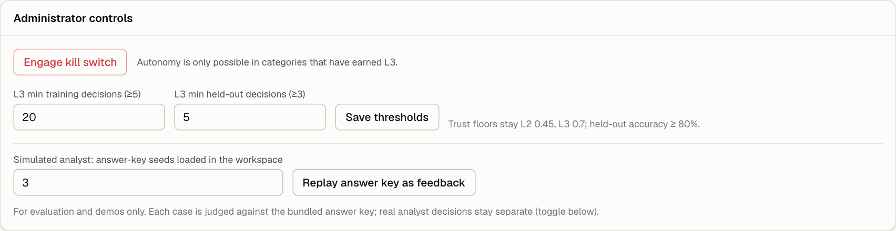

**The feedback loop in practice.** In the staged demo an analyst accepted the agent's "Cross-system fraud" conclusion, and trust rose from 0.009 to 0.034. A supervisor rejected a transfer recommendation because the customer confirmed it and the payee name matched; trust fell from 0.062 to 0.058, and the feedback-learning agent wrote: *"Prioritize direct customer confirmation and name verification over account age and transaction history when assessing transfer legitimacy."*

### 7.3 Agent evaluation

**Sealed benchmark.** 19 cases from seeds 201 and 202 were scored against their answer keys. These cases were never used for training, tuning or lessons.

| Agent | Correct | Accuracy | Citation grounding |
|---|---|---|---|
| Deterministic tool agent | 18 / 19 | 94.7 % | 1.00 |
| LLM agent team (gpt-4o-mini) | 18 / 19 | 94.7 % | 0.99 |

Both agents miss the same case, one the answer key marks as not fraud. On this data the LLM team **matches but does not beat** the deterministic agent on category accuracy. What it adds is investigative depth: competing hypotheses, the SQL it ran, a reviewer score and lessons. The Evaluation page also reports, from live feedback: agent correctness, analyst override rate, trust calibration by confidence band, false-positive handling, grouping quality (split rate) and autonomous-action safety (allow-list violations, customer-impacting actions taken by the agent).

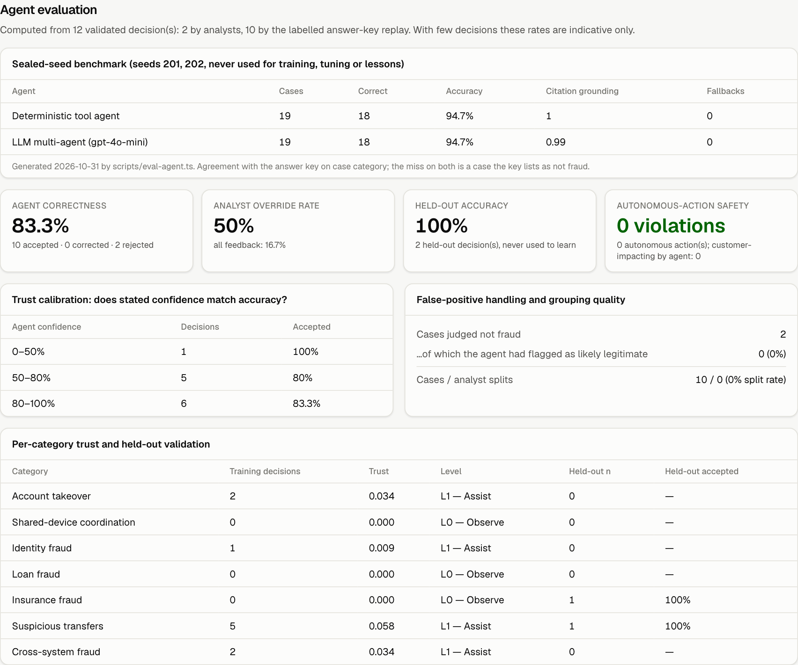

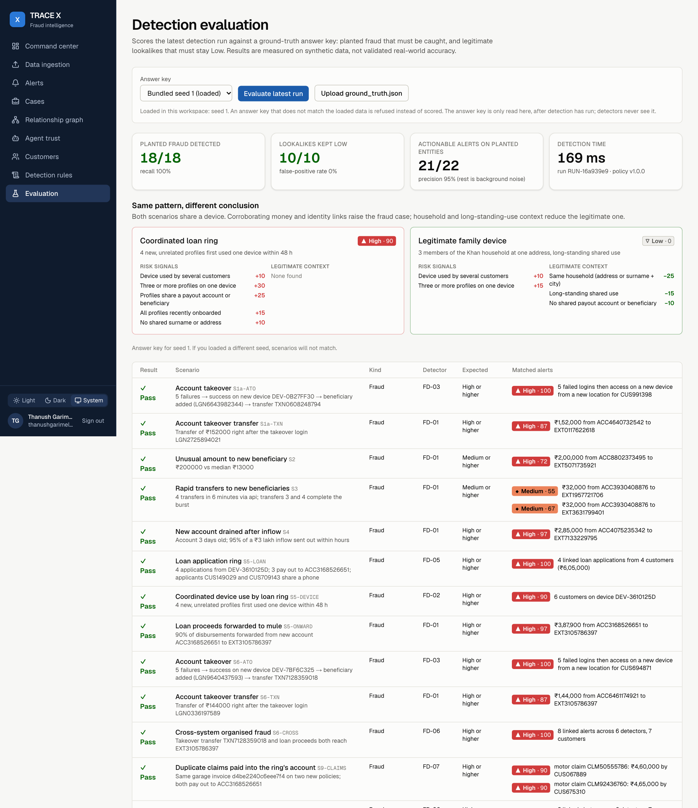

---

## 8. What we built beyond the brief

1. **Enriched data fields that real banks have.**
    - **Login events:** SIM-swap age, remote-access or screen-share tool, emulator or rooted device, VPN or proxy, session length, and a behavioural-biometric anomaly score.
    - **Transfers:** the verify-payee (beneficiary name check) result, which RBI's 2025 rules made available for RTGS and NEFT and NPCI's lookup provides for UPI and IMPS.

    They are optional columns with header aliases and validation, used by the takeover and transfer rules and by the graph model. When they are missing, everything still works. In BFSI these are the strongest signals for account takeover and authorised-push-payment fraud, and they rarely appear in fraud demos.

2. **Three separate opinions, never averaged into one.** Explainable rules, an Isolation Forest and a graph neural network each give their own verdict, so disagreement stays visible. The GNN uses no rule output; it does take the Isolation Forest percentile as one of its 26 inputs.
3. **Agents that cannot invent evidence.** The LLM proposes, and code checks every citation. The SQL agent cannot see the human decisions it is graded on.
4. **Learning with a proper held-out discipline.** The GNN is trained on seeds 1–3, tuned on 101 and tested once on sealed 201 and 202. Agent trust is validated on held-out cases, and held-out cases never teach the agent.
5. **Autonomy that is earned per category, can be revoked, and is bounded by allow-list and kill switch.** Customer-impacting actions are never autonomous at any level.
6. **Analyst corrections survive re-detection.** Splits persist, superseded cases keep their decisions, and every record is append-only, enforced by database triggers.
7. **Every number is computed.** Trust curves, evaluation metrics, exposure and priority come from stored data. Nothing on screen is typed in.
8. **Transparency for a shared workspace.** The activity log shows who loaded, reset, decided, approved or changed autonomy settings, and the dashboard shows which dataset and detection run are on screen.

---

## 9. Security and governance

- **Access control:** HMAC-signed session cookies, scrypt-hashed passwords, and role checks on every mutating route. The actor is always taken from the session, never from the request body.
- **Approvals:** customer-impacting approvals require an administrator other than the requester. Approval decisions are single-use and append-only.
- **Secrets:** stored only in Vercel environment variables (`TURSO_DATABASE_URL`, `TURSO_AUTH_TOKEN`, `TRACEX_SESSION_SECRET`, `OPENAI_API_KEY`). The app refuses to start on Vercel without a durable database and a strong session secret.
- **Guarded agent SQL:** single statement, SELECT only, an allow-listed set of tables, an outer row cap and no access to decisions or feedback.
- **Uploads:** capped at 4.5 MB; the end-to-end scripts refuse to reset a hosted workspace without an explicit flag.

---

## 10. Responsive and accessible interface

The interface works at phone width, with a 16 px gutter and no horizontal scroll. Every page supports light and dark themes. Filters and inputs have labels, the graph has a text description for screen readers, and status is never shown by colour alone.

| Mobile case view | Dark theme |
|---|---|
| 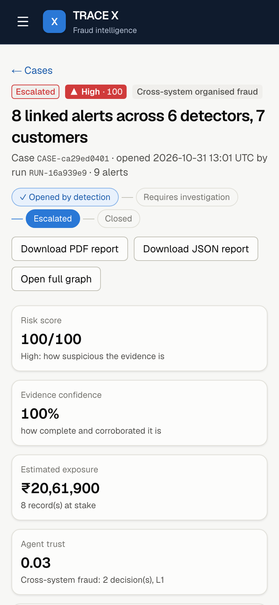 | 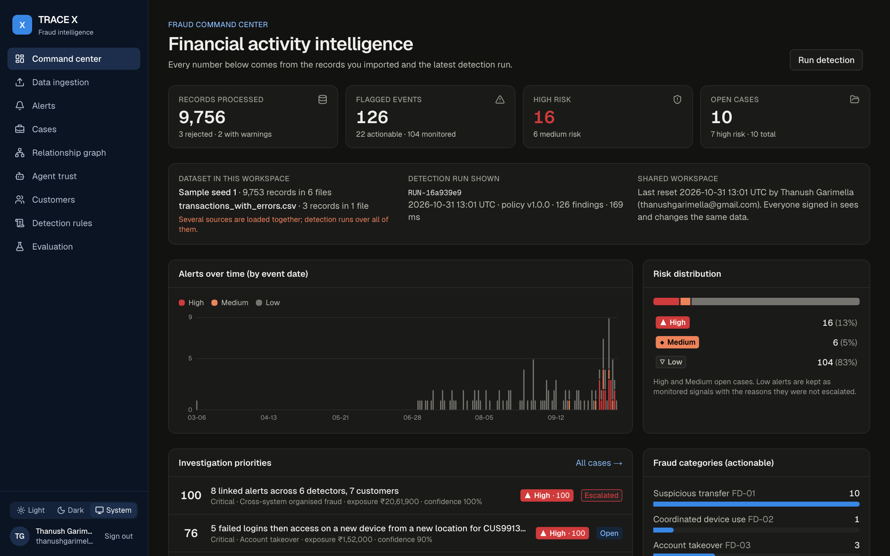 |

---

## 11. Testing and verification

| Suite | Count | Result |
|---|---|---|
| Unit and integration tests (`npm test`, in-memory databases) | 111 tests in 10 files | **All pass** |
| Lint (`npx eslint`) and type check (`npm run typecheck`) | — | **Clean** |
| Production build (`npx next build`) | — | **Succeeds** |
| Level 1 end-to-end (`node scripts/smoke.mjs <url> 1`) | 20 checks | **All pass** |
| Level 2 end-to-end (`node scripts/smoke-l2.mjs <url> 1`), with the real OpenAI key | 32 checks | **All pass** |
| Detection evaluation, seeds 1, 2, 3, 101, 201 and 202 | 18/18 fraud, 10/10 lookalikes each | **All pass** |
| GNN training and sealed test (`npx tsx scripts/train-model.ts`) | see section 6.2 | Reproducible |
| Agent sealed benchmark (`npx tsx scripts/eval-agent.ts`) | 19 cases | 18 / 19 |

**What the Level 2 tests prove:**

1. Correlation works through every required entity type, honours the time window and attenuates hubs.
2. Every graph edge resolves to source records.
3. Grouping is explained, analyst splits persist across re-runs, and an invalid split is refused.
4. All actions are recorded; history is immutable (UPDATE and DELETE are rejected by triggers); a reason is required.
5. Customer-impacting recommendations need a different, authorised approver and are never executed.
6. Exposure counts each record once; low-evidence cases become Needs More Evidence.
7. The PDF and JSON reports have zero unresolved references.
8. Agent output is structured, and every displayed claim resolves to records; a fabricated claim is dropped.
9. Correct feedback raises trust and incorrect feedback lowers it, in memory and in the database.
10. Categories without feedback stay at L0; L3 needs volume, trust and held-out accuracy together.
11. Crossing the L3 threshold allows only allow-listed, reversible actions; the kill switch blocks them.
12. The SQL guard rejects writes and hidden tables.
13. The multi-agent pipeline drops fabricated IDs, repairs failed SQL and filters disallowed actions.
14. Lessons come only from training-split feedback.
15. The GNN ranks fraud-linked customers well on a sealed seed.
16. All 64 Level 1 tests still pass.

---

## 12. Five-minute demonstration

1. **Command center (30 s).** Show the dataset and detection run on screen and the investigation priorities. Open the top Critical case, "8 linked alerts across 6 detectors, 7 customers".
2. **Scores (30 s).** Walk through the score strip: risk, confidence, exposure (₹20.6 lakh), agent trust and priority, kept separate. Open the breakdown.
3. **Graph (60 s).**
    - Click the shared payout account to see the loan disbursements and claim payouts behind it.
    - Click the external mule account, which links the loan ring to an unrelated customer's takeover.
    - Filter to suspicious links, then jump from an edge to its timeline event.
4. **Consolidation and correction (45 s).** Show the shared entities and matching fields. Split the takeover alert into its own case with a reason, re-run detection, and show that it stays split.
5. **Agent team (60 s).**
    - Run the multi-agent investigation and walk through orchestrator, hypothesis, SQL and reviewer.
    - Show the SQL it ran and the 12/12 verified citations.
    - Reject or correct the recommendation, then show the trust change and the lesson it wrote.
6. **Human authority (30 s).** As the analyst, recommend a temporary hold. As the administrator, approve it, and show that it is recorded but nothing is executed.
7. **Autonomy (45 s).** On Agent Trust, run the labelled answer-key replay, point to a red ring where trust fell, lower the L3 thresholds to their floor, and show the allow-listed autonomous actions in the audit log. Then engage the kill switch.

---

## 13. Limitations and next steps

**Limitations:**

- **Synthetic data:** all datasets are synthetic with planted scenarios. Held-out results show that the methods generalise across datasets, not that they would reach this accuracy on real data. Validation on a bank's labelled history is the next step.
- **Fixed graph propagation:** the GNN does not learn its neighbourhood aggregation. GraphSAGE or GAT become worthwhile at bank scale with GPU training.
- **LLM variability:** LLM output varies from run to run. Verification bounds what reaches the screen but cannot make the reasoning deterministic.
- **Trust needs volume:** reaching L2 or L3 needs many human decisions per category. The answer-key replay is a labelled simulated analyst for demonstrations and is shown separately from human feedback.
- **One shared workspace:** a production deployment would add tenant isolation, SSO and an operations-system integration for approved recommendations.

**Next steps:**

- **Model hardening:** calibrate the GNN with temporal splits, and add drift monitoring on model inputs.
- **Data and integration:** connect live telemetry from device-intelligence SDKs and payee checks from the payment switch, and add case assignment and SLAs.
